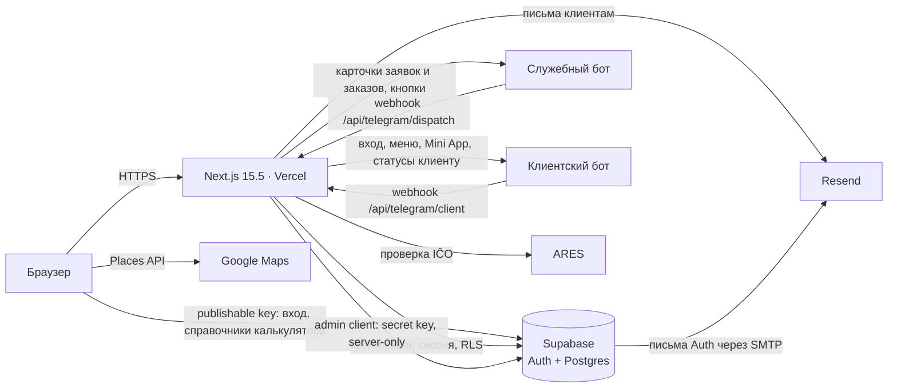

# CURRENT — архитектура Skoro (skoro-web)

> **Источник правды по архитектуре.** Заменяет [AS-IS.md](AS-IS.md), который остаётся как историческая реконструкция.
> Версия от 2026-11-05. Основа: `feature/bot-clients` @ `7bb387b` (`dev` с пакетами архитектора 2026-10-31 и 2026-11-02), пакет архитектора от 2026-11-05.
> Документ меняет только архитектор. Исполнитель предлагает изменения через [PROPOSALS.md](PROPOSALS.md).
> Текущее состояние работ: [../STATE.md](../STATE.md). Текущая работа: [пилот бота](../tasks/bot-client-pilot.md) (`docs/TASK.md` на время пилота не используется, §10).

## 1. Система и границы

Skoro — курьерская служба в Брно (CZ) для бизнеса и частных лиц. Основной фокус — B2B; раздел для частных лиц вернулся решением владельца (P-31, P-42). Веб-приложение — это одновременно маркетинговый сайт и рабочий инструмент. Состоит из:

- лендинга (версии «бизнес / частное лицо») с калькулятором и страницами услуг;
- приёма заявок и подписки на рассылку;
- служебного Telegram-бота: заявки, позже заказы и курьеры;
- личного кабинета клиента: заказы, абонемент, платежи.

В плане — оплата онлайн.

Один деплоймент Next.js на Vercel и один проект Supabase, общий для прода и всех Preview (ADR-0002, дополнение). Отдельного бэкенда нет и не планируется. Серверная логика живёт в Server Actions и Route Handlers Next.js, транзакционная — в функциях Postgres.



Отклонения от правил сейчас:
- калькулятор читает справочники из браузера — уберёт TASK-004;
- заказ создаётся RPC из браузера — уберёт TASK-005.

## 2. Принятые решения

| ADR | Решение | Статус |
|---|---|---|
| [0001](adr/0001-branches-and-deploy.md) | `main` — прод, `dev` — интеграция, `feature/*` → PR в `dev`; деплой только через Git-интеграцию Vercel | принято, выполнено |
| [0002](adr/0002-schema-as-code.md) | Схема БД — только миграциями. **Дополнение 2026-10-31:** в задаче — только расширение схемы, совместимое с `main`; сужение — после релиза | принято |
| [0003](adr/0003-server-write-path.md) | Все записи — через Server Actions / Route Handlers; Supabase-клиенты со строгими ролями | принято |
| [0004](adr/0004-pricing-single-source.md) | Тарифы в БД, формулы в `lib/pricing`, авторитетная цена на сервере. **Уточнение 2026-10-31:** три источника цены, индивидуальные цены клиентов, модель P-38 — TASK-004 | принято |
| [0005](adr/0005-client-account.md) | Кабинет: клиенты → точки → пользователи, вход по приглашению, путь заказа через сервер и Telegram | принято; изменено ADR-0006; TASK-005 отложена |
| [0006](adr/0006-client-options-and-bot-orders.md) | Опции клиента (вид тарифа + параметры, вид формы + предзаполнение), вход в бот по приглашению, заказ через Mini App, уведомления клиенту | принято, пилот бота |

**Сквозные правила:**

- **Валидация** — zod, только на сервере. zod не попадает в клиентский бандл: клиентские константы лежат в отдельном `constants.ts`.
- **Ошибки** возвращаются кодами, тексты для пользователя живут в UI.
- **Env** читаются лениво. Отсутствие ключа ломает фичу, а не рендер страницы или сборку. Серверные ключи — без `NEXT_PUBLIC_`.
- **Бизнес-время** — `Europe/Prague`, считается на сервере. Время из `datetime-local` трактуется как пражское, где бы ни был браузер.
- **Побочные эффекты** (письма, уведомления, правка сообщений) выполняются через `after()` или после записи, не откатывают основную операцию. Факт выполнения хранится в БД (`client_notified_at` и т. п.). Обработчик идемпотентен, повтор — кнопкой. Автоматический досыл (cron) пока не нужен (P-30).
- **Миграции совместимы с `main`** (ADR-0002, дополнение).
- **Юридические тексты** (политика, согласия, условия) исполнитель пишет и меняет только по прямой команде владельца.

## 3. Слои и модули

| Слой | Где | Правило |
|---|---|---|
| Маршруты | `src/app/**` | RSC по умолчанию. `"use client"` — только для интерактива |
| UI | `src/components/**` | Не ходит в БД сам. Получает данные пропсами или вызывает action |
| Домен | `src/lib/<domain>/` | Чистые функции и actions домена. Зависимости направлены вниз: UI → domain → infra |
| Инфраструктура | `src/lib/supabase/*`, `src/lib/maps/*`, `src/lib/email/resend.ts` | Фабрики клиентов, внешние SDK и API |
| Типы БД | `src/types/database.ts` | Только генерация, руками не правится (исключение — временно до применения миграции, с пометкой в STATE) |

**Доменные модули:**

| Модуль | Что делает |
|---|---|
| `lib/leads/` | Заявки: схема, ARES, телефон, фото, антиспам, уведомление. **Эталон** для новых доменов |
| `lib/newsletter/` | Подписка из футера (P-40) |
| `lib/telegram/` | Служебный бот (корень) и клиентский бот (`client/`, ADR-0006 §4); общий код — в корне. Внутри модуля — относительные импорты с `.ts` (скрипты без бандлера) |
| `lib/email/` | Письма клиентам через Resend |
| `lib/pricing/` | Только чистые функции цены (ADR-0004) |
| `lib/calculator/` | Формулы калькулятора до TASK-004 и оценка конкурентов |
| `lib/orders/` *(ADR-0006)* | Заказы: пражское время и слот, `submitOptionOrder`, статусы, запросы |
| `lib/options/forms/` *(ADR-0006)* | Реестр видов форм опций (пилот — `city_delivery`) |
| `lib/pricing/tariffs/` *(ADR-0006)* | Реестр видов тарифов (пилот — `slot_table`, `flat`) |

Шаблон доменного модуля:

```
lib/<domain>/
  constants.ts   client-safe константы и типы (без zod)
  schema.ts      zod-схемы, нормализация; server-side
  actions.ts     "use server"; validate → authorize → persist → after()
  *.ts           чистая логика и доступ к данным
  *.test.ts      vitest на чистые функции
```

**Supabase-клиенты** (ADR-0003):

| Клиент | Ключ | Где | Назначение |
|---|---|---|---|
| `lib/supabase/client.ts` | publishable | client components | Вход и выход; калькулятор до TASK-004 |
| `lib/supabase/server.ts` | publishable + cookie | динамические RSC, actions, route handlers | Всё от имени пользователя, RLS действует |
| `lib/supabase/admin.ts` | secret, `server-only` | actions, route handlers, бот | Системные записи (лиды, подписка, бот) и внутренние SQL-функции **после** явной проверки прав в коде |

## 4. Маршруты

| Путь | Что | Статус |
|---|---|---|
| `/` | Лендинг | `○` Static. ISR цен — TASK-004 |
| `/services/[slug]` | 7 страниц услуг (`lib/services.ts`) | SSG, `noindex` пока нет текста (P-41) |
| `/personal`, `/personal/[slug]` | Раздел для частных лиц: `price`, `how-to-order`, `faq` | SSG, `noindex` пока нет текста (P-42) |
| `/insurance`, `/contract` | Страницы доверия | Static, `noindex` пока нет текста |
| `/login` | Вход | Static. TASK-005: русский текст, «Забыли пароль?», P-26 |
| `/dashboard/*` | Кабинет: обзор, заказы, новый заказ, абонемент, платежи | TASK-005 — ADR-0005 |
| `/auth/confirm` *(TASK-005)* | Подтверждение ссылок из писем Auth (`verifyOtp`) | — |
| `/auth/callback`, `/auth/signout` | Обмен кода и выход | `next` — только внутренний путь (TASK-005) |
| `/api/telegram/dispatch` | Вебхук служебного бота (админы) | Работает при верном `TELEGRAM_BOT_TOKEN` в Vercel |
| `/api/telegram/client` *(ADR-0006)* | Вебхук клиентского бота (клиенты, гости) | — |
| `/tg/order/[clientOptionId]` *(ADR-0006)* | Mini App: форма опции | доступ только с проверенным `initData` |

**Слаги** страниц услуг — английские до решения по i18n; при языковых версиях маршруты получат префикс языка, слаги пересматриваются там же (P-41).

`middleware.ts` работает только на `/dashboard/:path*`, `/login`, `/auth/:path*`.

## 5. Данные

Источник истины — миграции (ADR-0002). Фактический доступ — [db-security.md](db-security.md).

| Таблица | Назначение |
|---|---|
| `zones`, `zone_distances` | Зоны Брно и матрица расстояний (пуста) |
| `delivery_slots` | Слоты: цена, запас времени. Источник цен `Tariffs` и запасной вариант для клиентов |
| `skoro_pricing` | Одна строка ставок калькулятора (до TASK-004) |
| `service_config` | Рабочие часы |
| `retail_points` | Данные режима «из магазинов» калькулятора |
| `leads` | Заявки с сайта: контакты, маршрут, получатель, IČO / ARES, оплата, номер, кто обработал, письмо клиенту |
| `newsletter_subscribers` | Подписка из футера (миграция не применена, P-40) |
| `clients`, `client_contacts`, `client_locations` *(ADR-0006)* | Клиенты, их люди (с Telegram) и точки |
| `service_options`, `client_options` *(ADR-0006)* | Каталог опций; опции клиента с тарифом и предзаполнением формы |
| `telegram_users`, `notifications`, `bot_sessions` *(ADR-0006)* | Пользователи ботов; факты отправки уведомлений; состояние диалогов |
| `profiles` | Пользователь кабинета; `client_id` — с TASK-005 |
| `orders`, `subscriptions`, `payments` | Заказы, абонементы, платежи; `client_id` — с TASK-005 |

**Целевая матрица доступа:**

| Таблицы | anon | authenticated | Запись |
|---|---|---|---|
| Справочники: `zones`, `zone_distances`, `delivery_slots`, `skoro_pricing`, `service_config`, `retail_points` | select | select | миграции и SQL Editor владельца |
| `clients`, `client_contacts`, `client_locations`, `service_options`, `client_options` | — | select своего клиента — с веб-кабинетом (TASK-005); до этого только сервер | SQL Editor владельца, сервер (приглашения) |
| `telegram_users`, `notifications`, `bot_sessions` | — | — | только сервер |
| `orders`, `subscriptions`, `payments` | — | select строк своего клиента (и свои по `user_id` до contract) | только сервер |
| `profiles` | — | select своей строки | владелец / сервер |
| `leads`, `newsletter_subscribers` | — | — | только сервер (admin) |

Функции с `security definer` обязаны иметь `set search_path = ''`, а `execute` у них отозван у `public`, `anon` и `authenticated`, если прямой вызов из клиента не предусмотрен явно. Отклонение сейчас одно — `create_order_for_user`, закрывается contract-шагом после релиза TASK-005.

## 6. Ключевые потоки

**Заявка (эталон).**
1. `ContactForm` → `submitLead`.
2. honeypot и time-trap → zod → rate-limit по `ip_hash` → ARES для компании.
3. Запись через admin-клиент.
4. `after()`: сообщение в группу «Заявки» с кнопками (и фото ответом).
5. Админ нажимает «Взял в работу» → условный update → письмо клиенту (Resend) → правка сообщения.

**Заказ клиента (пилот бота, ADR-0006 §6–§7).**
1. Клиентский бот → Mini App формы опции → `submitOptionOrder`: `initData` → контакт → клиент → опция → zod вида формы → слот по Europe/Prague → тариф опции.
2. Admin-клиент вызывает `create_option_order` — атомарно, со снимком формы и цены.
3. `after()`: служебный бот шлёт карточку в «Заявки» с кнопками «Принять / Отклонить», затем «Доставлен»; клиентский бот — подтверждение клиенту.
4. Статусы: клиенту — сообщение клиентского бота и письмо; факт отправки — в `notifications`.
5. Веб-кабинет (переписанная TASK-005) станет вторым каналом той же функции с `created_via = 'web'`.

**Калькулятор (сейчас).** Справочники читаются из браузера, формулы — `lib/calculator`. После TASK-004 — модель P-38 через `lib/pricing`.

**Оплата (цель, TASK-006).** Сумма считается только на сервере. Статус меняет только вебхук провайдера. Перед этой задачей — отдельный staging-проект Supabase.

## 7. Интеграции

| Система | Назначение | Конфиг | Статус |
|---|---|---|---|
| Supabase | Auth, Postgres | `NEXT_PUBLIC_SUPABASE_URL`, `NEXT_PUBLIC_SUPABASE_ANON_KEY`, `SUPABASE_SECRET_KEY` | используется. TASK-005: SMTP Auth через Resend, шаблоны с `token_hash`, регистрация выключена |
| Telegram — служебный бот | Карточки заявок и заказов с кнопками в группе «Заявки», `/invite`; вебхук на прод-домене | `TELEGRAM_BOT_TOKEN`, `TELEGRAM_CHAT_ID`, `TELEGRAM_WEBHOOK_SECRET`, `TELEGRAM_ADMIN_IDS` | используется. **Риск GDPR:** у Telegram нет договора обработки данных |
| Telegram — клиентский бот *(ADR-0006)* | Вход по приглашению, меню, Mini App заказа, «Мои заказы», статусы клиенту | `TELEGRAM_CLIENT_BOT_TOKEN`, `TELEGRAM_CLIENT_WEBHOOK_SECRET`, `TELEGRAM_CLIENT_BOT_USERNAME`, `APP_URL` | пилот |
| Resend | Письма клиентам (домен `notify.skorouvas.cz`, регион EU); с TASK-005 — и письма Auth через SMTP | `RESEND_API_KEY`, `EMAIL_FROM`, `EMAIL_REPLY_TO` | используется (P-29) |
| ARES | Проверка IČO, название фирмы | без ключа | используется (P-31). Отдельный rate-limit для живой проверки — бэклог |
| Google Maps Places | Подсказки адресов. Форма — Places API (New); калькулятор — старый виджет (P-33) | `NEXT_PUBLIC_GOOGLE_MAPS_API_KEY` — ограничить по HTTP referrer, включить Places API (New) | используется |
| Антиспам | Хэширование IP (заявки, подписка) | `LEAD_IP_SALT` | используется |
| Google Fonts | `next/font`, отдаются с нашего домена | — | у основного шрифта нет кириллицы (P-37) |

## 8. Платформа и окружения

| Что | Решение |
|---|---|
| Node | 22 LTS (`engines >=22.12`, `.nvmrc`, Vercel 22.x). До 2027-04-30 — переход на 24 LTS |
| Next.js | 15.5.x с патчами. Next 16 — отдельная задача (бэклог) |
| Supabase | Один проект `skoro_web` (ref `ukdxpdprxkcslydfobno`) на прод и все Preview. Перед TASK-006 — staging |
| Supabase CLI | Только с `--db-url` (Session pooler): `--linked` из сети владельца не работает. Миграции: `npx supabase db push --db-url "$DB_URL"` — применяет владелец |
| Качество | CI на PR в `dev` и `main`: `tsc --noEmit`, `eslint .`, `vitest`, `next build` |
| `npm audit` | Остаток в зависимостях сборки (Tailwind 3, `postcss` в `next`) принят до миграций на Tailwind 4 и Next 16 |

**Vercel (P-27):**

| Настройка | Значение |
|---|---|
| Проект | `skoro-web-st78`, домен `skorouvas.cz`, Git → `aske3t/skoro_web` |
| Production Branch | `main`; Preview — каждая ветка |
| Node.js Version | 22.x |
| Env (Production и Preview) | все переменные из `.env.example`; секреты — тип Secret; новая переменная заводится сразу в обоих окружениях; после изменения — Redeploy |
| Вебхуки ботов | Боевые: служебный — `https://skorouvas.cz/api/telegram/dispatch`, клиентский — `…/api/telegram/client`. Dev-боты — на адрес ветки с обходом защиты Preview (ADR-0006 §8). Скрипты: `npm run bot:webhook -- --bot service|client` (`--delete` — снять). Локальный `bot:dev` — только при снятом вебхуке этого бота |

**Релиз `dev` → `main`** — по команде владельца:
1. Перед PR: `grep -rn "TODO(владелец)" src` — плейсхолдеры, видимые на сайте, заполнены или скрыты (P-41); миграции из `dev` применены.
2. PR `dev` → `main`, CI зелёный, Merge. Vercel сам пересобирает прод.
3. Смоук на `skorouvas.cz`: главная, калькулятор, тестовая заявка → Telegram, вход → кабинет.
4. Откат: Vercel → Deployments → предыдущий продакшен-деплой → Instant Rollback; затем revert-PR в `main`.
5. Contract-миграции следующей задачи — только после шага 3.

Прямые PR в `main` в обход `dev` (как PR #6) не делаются: после них `main` и `dev` расходятся.

## 9. Известные проблемы и где они решаются

| Проблема | Где |
|---|---|
| Заказ из кабинета не уходит никому; RPC из браузера; слот по часам браузера; P-22, P-24, P-26; открытый редирект в `next` | **TASK-005** |
| Юридические страницы (политика, cookies, условия, рекламации) — плейсхолдеры; текст под формой; согласие подписки (P-40) | по команде владельца; **блокирует релиз раздела для частных лиц и подписки в `main`** |
| Персональные данные клиентов и получателей уходят в Telegram (нет договора обработки) | бэклог: режим «уведомление без данных + ссылка в админку» |
| Калькулятор загружает Google Maps при открытии главной; старый виджет Places (P-33) | TASK-004 |
| Цены в нескольких местах, модель P-38 не внедрена, `zone_distances` пуста | TASK-004 |
| `lang="en"`, шрифт без кириллицы, курсив Oswald, якоря, `.reveal` без JS (P-37); ошибка гидратации #418 (P-34) | задача «гигиена лендинга» (бэклог) |
| Вебхук бота на проде отвечал 500 (токен в Vercel) | владелец: токен → Redeploy → `getWebhookInfo` |
| `orders.payment_status` default `'paid'`, каскадное удаление от `auth.users`, нет `check` | TASK-005 (`orders`, `subscriptions`), TASK-006 (`payments`) |
| Отдельный rate-limit для живой проверки IČO в ARES | бэклог |

## 10. Дорожная карта

- ✅ **TASK-001** — контактная форма → лиды.
- ✅ **TASK-002** — фундамент: baseline схемы, аудит доступа, Node, ESLint и CI.
- ✅ **TASK-003** — доступ к БД, статический лендинг, ветка `main`.
- ✅ **Работы по запросам владельца 2026-10-13…31** — бот (шаги 1–2), форма заявки, письма, ARES, версии сайта, редизайн секций, футер, страницы-шаблоны.

**Дальше:**
1. **Пилот клиентского бота** (ADR-0006): отдельный клиентский бот рядом со служебным, опции и тарифы, вход по приглашению, заказ через Mini App, уведомления клиенту, поле времени на сайте. Два клиента, опция «Доставка по городу». План — `docs/tasks/bot-client-pilot.md`, описание ботов — `docs/telegram-bot.md`, без `docs/TASK.md`.
2. **TASK-005 — веб-кабинет** — переписывается после пилота поверх ADR-0006.
3. Порядок дальше выбирает владелец: юридический пакет (по команде владельца), курьеры в боте, TASK-004 (движок цен P-38 — новый вид тарифа), TASK-006 (оплата).

**Идеи для кабинета (к выбору владельца):**
- повтор заказа и адресная книга (повтор — уже в TASK-005);
- регулярные доставки по расписанию;
- подтверждение доставки (фото, подпись) — вместе с курьерами;
- счета и акты за период (PDF / ISDOC);
- роли сотрудников компании;
- импорт заказов CSV, интеграция с Shoptet / WooCommerce;
- доверенности для документных поручений;
- заказ на выкуп со списком и бюджетом;
- отчёты по точкам;
- подключение Telegram и уведомления клиенту.

**Бэклог:**
- подписка: double opt-in, отписка, сервис рассылок (P-40);
- онбординг и админка клиентов вместо SQL-сниппетов;
- трекинг заказа для получателя;
- гигиена лендинга (P-34, P-37);
- Next 16 и Tailwind 4, Node 24;
- i18n (cs / en / ru) и локаль писем (P-29).

## 11. Журнал решений по PROPOSALS (2026-10-02)

| # | Решение |
|---|---|
| P-01 | ADR-0001. `main` создаётся от `ec05ede` (это содержимое живого сайта, проверено архитектором), тег `prod-2026-05-17`. `master` и `variant1` удаляются после переключения Vercel |
| P-02 | ADR-0002. Baseline в TASK-002: `link` → `migration repair` (leads) → `db pull`. Staging — перед TASK-006 |
| P-03 | Node 22 LTS в трёх местах (TASK-002); переход на 24 — до 2027-04 |
| P-04 | Остаёмся на 15.5.x: откат незакоммиченного Next 16, `npm audit fix` без `--force`. Next 16 — бэклог |
| P-05 | ADR-0003. Все записи через сервер; `createOrder` → Server Action (TASK-005) |
| P-06 | Navbar статичный; статус входа — клиентский островок на browser-клиенте (UI-индикация, не защита). Защита остаётся в `dashboard/layout.tsx`. Matcher middleware сужается. TASK-003 |
| P-07 | ADR-0004 |
| P-08 | Сейчас только B2B. Аккаунты создаёт владелец в Supabase до задачи онбординга. Ссылку `/personal` убрать (TASK-003). **Трекинг — ждёт решения владельца** |
| P-09 | Google Places — единственный геокодер; Nominatim удалить (TASK-002) |
| P-10 | Вместо абсолютной метки — длительность заполнения по часам клиента: `elapsedMs` = submit − mount, оба значения на одном устройстве. HMAC не нужен, со статическим лендингом совместимо (TASK-002) |
| P-11 | ESLint 9 (flat config, `eslint-config-next` 15.5.x), скрипт `eslint .` (`next lint` устарел); GitHub Actions на PR (TASK-002) |
| P-12 | Принято целиком (TASK-002) |

## 12. Журнал решений по PROPOSALS (2026-10-06)

| # | Решение |
|---|---|
| P-08 | Форма трекинга в Hero заменяется двумя CTA: «Рассчитать стоимость» → калькулятор, «Оставить заявку» → контактная форма (TASK-003). Сам трекинг — бэклог после TASK-005 |
| P-13 | В TASK-003: `@supabase/ssr` ^0.12.7 + актуальная `supabase-js` 2.x, `<Database>` на всех клиентах, `p_comment: undefined` вместо `null`. TASK-003 всё равно переписывает работу с сессией в Navbar и middleware |
| P-14 | 🔴 Первый блок TASK-003: политика чтения `service_config` для `anon` и `authenticated` + защита страницы от отсутствия строки |
| P-15 | Подтверждено: цена — TASK-004; проверка слота по времени и `valid_until` — TASK-005 |
| P-16 | TASK-005. `execute` у `public` и `anon` отзывается уже в TASK-003: это бесплатно и закрывает анонимный вызов |
| P-17 | `pg_net` не нужен: внешние вызовы и вебхуки идут через Route Handlers (ADR-0003). Строка `drop extension` в baseline отражает реальность — на удалённой БД расширения нет, оно есть только в образе для diff. Baseline не трогаем. Закрыто |
| P-18 | TASK-004: матрица заполняется вместе с переносом тарифов в БД. В TASK-003 только диагностика `count(*)` |
| P-19 | `orders`: default `'pending_payment'` (значение, которое уже пишет RPC) + `check` по списку статусов, FK на `auth.users` → `restrict` — TASK-005. `payments` — TASK-006 |
| P-20 | Grants и политики — TASK-003: запись у `anon` и `authenticated` отзывается на всех таблицах `public`, включая default privileges, политики получают явные роли. `check`-ограничения — TASK-005 |
| P-21 | Бэклог, задача онбординга B2B |
| — | Остаток `npm audit` принят (§8) |
| — | Supabase CLI работает через `--db-url` (§8) |

## 13. Журнал решений по PROPOSALS (2026-10-31)

Пакет архитектора от 2026-10-13 (TASK-004 с «плоской» моделью цены) в репозиторий не попал и отозван; актуальные решения — ниже и в ADR-0004 (уточнение 2026-10-31).

| # | Решение |
|---|---|
| P-08 | Пересмотрено: частные лица возвращаются — в заявке (P-31) и разделом `/personal/*` (P-42). Трекинг — бэклог после TASK-005 |
| P-18 | `zone_distances` — в TASK-004 вместе с выбором источника расстояний (P-38) |
| P-22 | TASK-005: заголовки из `setAll` ставятся на ответ middleware |
| P-23 | Закрыто: футер переписан (`9ed215d`) |
| P-24 | TASK-005: кабинет без публичных env показывает «Кабинет временно недоступен» и телефон |
| P-25 | Закрыто: логотип в потоке шапки |
| P-26 | TASK-005: `try / catch / finally` в форме входа, ошибки кодами |
| P-27 | Описано в §8. Закрыто |
| P-28 | Кнопки заявки — сделаны (админы). Раздача курьерам и «отклонить» курьером — задача «курьеры в боте» после выбора модели владельцем. Заказы кабинета идут в ту же группу (ADR-0005) |
| P-29 | Resend принят (§7). Локаль письма — колонка при i18n |
| P-30 | Правило побочных эффектов — §2. Кнопки повтора достаточно, cron не нужен |
| P-31 | Принято задним числом: тип клиента, IČO, ARES (§7). Rate-limit живой проверки ARES — бэклог |
| P-32 | Выбор версии в `localStorage` — для формы; разделы с контентом — маршруты (`/personal/*`). Синхронизация переключателя с маршрутом — гигиена лендинга |
| P-33 | TASK-004: калькулятор на `AddressInput` / Places API (New), старый хук удалить |
| P-34 | Бэклог: гигиена лендинга |
| P-35 | ADR-0004, уточнение 2026-10-31: тарифы по аудиториям — TASK-004 |
| P-36 | Принято задним числом (`message` необязателен для доставки) |
| P-37 | Бэклог: гигиена лендинга (`lang`, шрифт с кириллицей, курсив, якоря, `.reveal`) |
| P-38 | Модель владельца — цель TASK-004; нужен источник расстояний (ADR-0004, уточнение) |
| P-39 | Текст в `message` до TASK-004; структурированный расчёт — вместе с серверной ценой |
| P-40 | Предложение агента принято: подписку не выпускать в `main` без применённой миграции, текста согласия, политики, double opt-in и отписки |
| P-41 | Маршруты и английские слаги приняты до i18n; контент — в коде; плейсхолдеры не выпускать в `main` (§8, релиз). Способы оплаты — вход для TASK-006 |
| P-42 | Принято: `/personal/*` — раздел для частных лиц |

## 14. Журнал решений по PROPOSALS (2026-11-05)

| # | Решение |
|---|---|
| P-43 | Вариант В, решение владельца: два бота. Служебный (нынешний) — карточки и кнопки в группе, `/invite`; клиентский (новый) — вход, меню, Mini App, статусы клиенту. Общие сервер и БД. ADR-0006 §4, §5, §6, §7, §8 изменены; шаги 0 и 3–6 пилота переписаны |
| P-44 | Исправлено: CURRENT §6 (заказ через `create_option_order`), ADR-0004 (`client_prices` и `resolveClientPrice` помечены заменёнными), ADR-0002 §4 (`--db-url`), `bot_sessions` в ADR-0006 §1 и CURRENT §5, ссылка на текущую работу в шапке. `CLAUDE.md` правит агент отдельным коммитом: убрать `api/geocode/search`, обновить список миграций и ботов |
| — | P-22…P-42 решены в §13. В PROPOSALS их перенести в «Решено», если ещё не перенесены |

